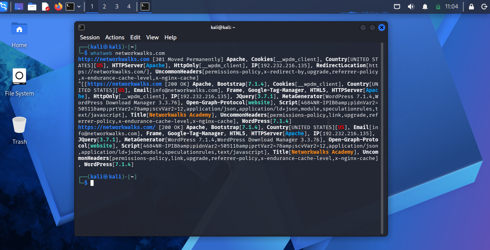
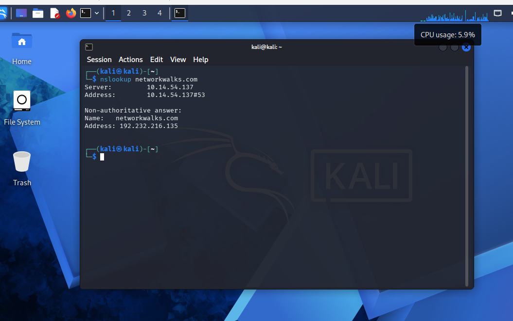
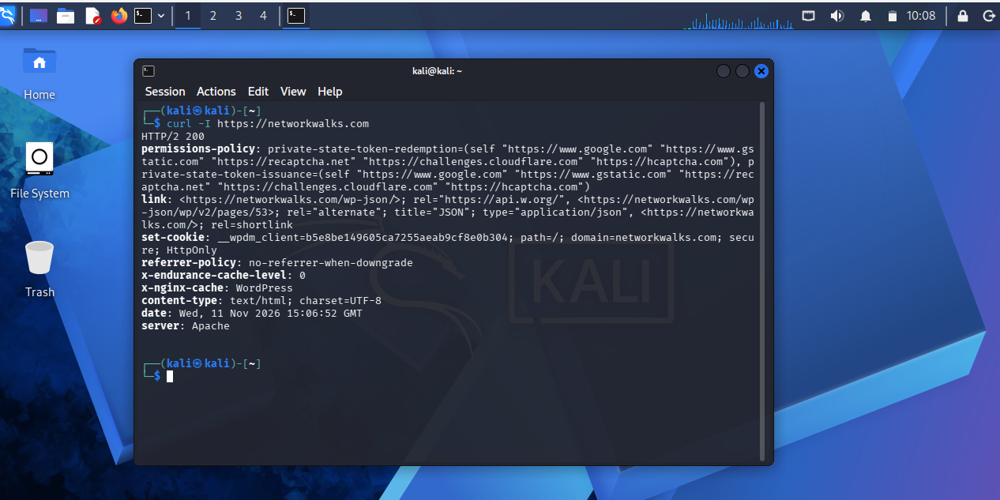
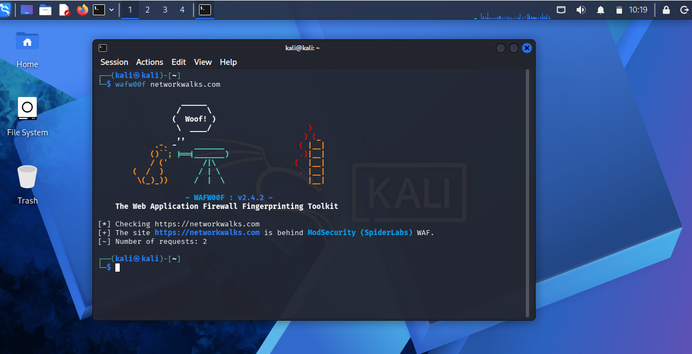
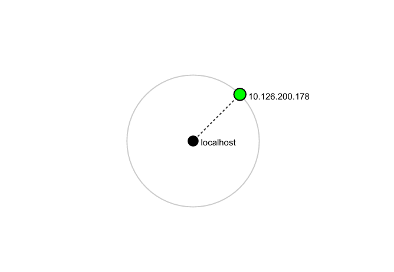

# 🛡️ Penetration Testing Report: Footprinting & Network Scanning Phases
**W2-PM-FINAL | Cybersecurity & Ethical Hacking Internship | Networkwalks (Batch B084)**


---

## 📋 Engagement & Project Metadata

| Field | Details |
| :--- | :--- |
| **Cybersecurity Professional** | Penius Jempa |
| **Program / Batch** | B084 — Networkwalks |
| **Date** | 12 November 2026 |
| **Modules Completed** | `W2-PM1` (Multiple Kali Tools) & `W2-PM5` (Zenmap Scanning) |
| **Client / Target Scope** | 1. `networkwalks.com` (Explicit written permission secured)<br>2. Local Area Network (`10.126.200.0/24` / Personal Lab LAN) |
| **Authorization Status** | ✅ Verified Written Permission Secured |
| **Phases Covered** | **Phase 1:** Reconnaissance & Footprinting<br>**Phase 2:** Scanning & Network Discovery<br>**Phases 3–5:** In Progress |

---

## ⚠️ 1. Liability & Legal Disclaimer

> **Strict Educational & Authorized Use Only:**  
> All reconnaissance and network scanning activities documented in this repository were performed strictly on systems where explicit written permission was obtained (`networkwalks.com`) or on personally owned local network hardware.  
> 
> These materials are published solely for educational and defensive research purposes. Unauthorized scanning, footprinting, or exploitation of systems without prior written consent is illegal in most jurisdictions and can result in criminal prosecution, fines, and permanent professional consequences. Neither the author nor Networkwalks assumes liability for misuse of this information.

---

## 📖 2. Overview & Objectives

This repository documents Week 2 of the **Networkwalks Cybersecurity & Ethical Hacking Internship**, bridging **Phase 1 (Footprinting & Reconnaissance)** and **Phase 2 (Scanning & Network Discovery)**:

1. **External Domain Footprinting (`W2-PM1`):** Gathering publicly exposed infrastructure, DNS, web stack, and WAF metadata for `networkwalks.com` using six command-line reconnaissance tools in **Kali Linux**.
2. **Internal Network Discovery (`W2-PM5`):** Identifying active hosts, IP/MAC mappings, and generating a visual network topology on a local LAN using **Zenmap (Nmap GUI)** and **Windows CMD**.

---

## 🛠️ 3. Tools & Environment

| Tool / Platform | Environment | Purpose |
| :--- | :--- | :--- |
| **Kali Linux & Windows** | OS / Lab | Host environments for external recon and internal scanning |
| **`whois`** | Kali Linux | Query domain registration records, registrar details, and name servers |
| **`whatweb`** | Kali Linux | Fingerprint web server software, CMS versions, plugins, and frameworks |
| **`nslookup`** | Kali Linux | Resolve target domain names to IPv4 addresses via DNS |
| **`curl -I`** | Kali Linux | Inspect raw HTTP response headers and exposed API endpoints |
| **`wafw00f`** | Kali Linux | Detect and fingerprint Web Application Firewalls (WAF) |
| **`dnsrecon`** | Kali Linux | Enumerate DNS records (`NS`, `MX`, `SPF`, `TXT`, `SRV`) |
| **Zenmap (Nmap GUI)** | Windows | Perform subnet ping sweeps, host discovery, and export network topology |
| **Windows CMD (`ipconfig`)** | Windows | Identify local interface IPv4 configuration, subnet mask, and MAC address |

---

## 🔍 4. Activities & Technical Findings

### 4.1 Phase 1: Footprinting & Reconnaissance (`networkwalks.com`)

Six passive and active reconnaissance utilities were executed from Kali Linux against `networkwalks.com`:

```bash
# 1. Domain Registration & Name Servers
whois networkwalks.com

# 2. Web Technology & CMS Fingerprinting
whatweb networkwalks.com

# 3. DNS Name-to-IP Resolution
nslookup networkwalks.com

# 4. HTTP Header & Endpoint Inspection
curl -I [https://networkwalks.com](https://networkwalks.com)

# 5. Web Application Firewall (WAF) Detection
wafw00f networkwalks.com

# 6. Comprehensive DNS Record Enumeration
dnsrecon -d networkwalks.com
```

#### Key Observations
* **Domain & Hosting (`whois`):** Registered via GoDaddy (Domain ID: `2452319255_DOMAIN_COM-VRSN`), using HostGator name servers (`NS6135.HOSTGATOR.COM`, `NS6136.HOSTGATOR.COM`), with `DNSSEC: unsigned`.
* **IP Resolution (`nslookup`):** Resolved `networkwalks.com` to `192.232.216.135`.
* **Web Stack (`whatweb`):** Identified Apache web server, WordPress 7.1.4, WP Download Manager 3.3.76, Bootstrap 7.1.4, and jQuery 3.7.1.
* **HTTP Headers (`curl -I`):** Returned HTTP/2 200 on Apache, exposed the WordPress REST API link header (`/wp-json/`), and revealed the `__wpdm_client` session cookie.
* **WAF Detection (`wafw00f`):** Confirmed active protection behind ModSecurity (SpiderLabs) WAF.
* **DNS Enumeration (`dnsrecon`):** Mapped NS, MX, SPF/TXT, and SRV records detailing mail and domain infrastructure.

---

### 4.2 Phase 2: Local Network Scanning (`Zenmap` & `Windows CMD`)

Internal network discovery was conducted on a local Windows host to map active devices and export a visual topology:

1. **Local Interface Discovery:** Ran `ipconfig /all` in Windows CMD to determine the local subnet and interface MAC address (`7C-76-35-8D-C5-39`).
2. **Host Discovery (`Ping Scan`):** Targeted the local subnet in Zenmap, identifying active live hosts including `10.126.200.178`.
3. **Topology Export:** Generated the visual node map in Zenmap's Topology tab with the legend enabled and exported the diagram to PDF.

---

## 📊 5. Risk Analysis & Impact Assessment

> **Note:** The items below represent reconnaissance observations from authorized footprinting and host discovery exercises—not confirmed exploitable vulnerabilities. No exploitation was performed.

| # | Observation / Finding | Evidence | Potential Impact | Risk Level |
| :-: | :--- | :--- | :--- | :-: |
| **1** | **Web Technology & Version Disclosure** | `whatweb` identified WordPress 7.1.4 & WP Download Manager 3.3.76 | Enables attackers to cross-reference exact plugin/CMS versions against known CVE databases | 🟡 **Medium** |
| **2** | **Origin Server IP Identifiable** | `nslookup` resolved domain to `192.232.216.135` | Exposes hosting network location for targeted infrastructure profiling | 🟢 **Low** |
| **3** | **HTTP Technical Headers & REST API Exposure** | `curl -I` exposed `/wp-json/` endpoint and server headers | Assists automated fingerprinting and user/endpoint enumeration | 🟢 **Low** |
| **4** | **WAF Architecture Identifiable** | `wafw00f` detected ModSecurity (SpiderLabs) | Reveals defensive perimeter technology, aiding evasion research | 🟢 **Low** |
| **5** | **DNS Infrastructure Exposure** | `dnsrecon` enumerated NS, MX, TXT/SPF, and SRV records | Helps adversaries map mail routing, third-party services, and DNS posture | 🟡 **Medium** |

---

## 🛡️ 6. Security Recommendations

* **Minimize Banner & Version Disclosure:** Configure WordPress, plugins, and Apache headers (`ServerTokens Prod`, `ServerSignature Off`) to suppress exact version numbers.
* **Patch Management:** Keep WordPress core, themes, and plugins (such as WP Download Manager) updated against current security advisories.
* **Harden HTTP Headers & API Endpoints:** Restrict unauthenticated access to `/wp-json/` where not required and audit exposed Link and custom cache headers.
* **Audit DNS Records & DNSSEC:** Periodically review public TXT/SPF and SRV records to remove stale entries and evaluate enabling DNSSEC.
* **Maintain & Tune WAF Rules:** Keep ModSecurity active with updated OWASP Core Rule Set (CRS) policies and continuous alert monitoring.
* **Routine Internal Asset Discovery:** Conduct scheduled internal subnet scans, verify unknown MAC/IP addresses against an authorized asset inventory, and maintain up-to-date network topology documentation.

---

## 📸 7. Evidence & Screenshots

| Module / Tool | Screenshot Preview |
| :--- | :--- |
| **WHOIS Lookup** |  |
| **WhatWeb Fingerprinting** |  |
| **Nslookup DNS Resolution** |  |
| **Curl HTTP Headers** |  |
| **Wafw00f WAF Detection** |  |
| **Zenmap Network Topology** |  |

---

## 👤 Author

**Penius Jempa**  
*Cybersecurity Professional — Batch B084 | BSc Computer Science Student*   
* 🐙 **GitHub:** [@Jempa13](https://github.com/Jempa13)  
* 🎓 **Program:** Cybersecurity & Ethical Hacking Internship — Networkwalks (Week 02)
